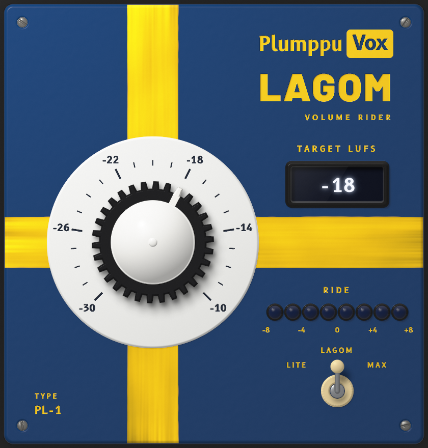

# PlumppuVox Lagom

A volume rider plugin (VST3) for speech. Set the knob to the loudness
you want, in LUFS, and Lagom rides the level of the voice towards it: quiet
passages come up, loud ones go down, and pauses are left alone. It is the
sibling of PlumppuVox Ren, the voice isolator.

- **Target** from -30 to -10 LUFS, in 1 dB steps. -18 by default.
- **Mode**, a three-way lever like a guitar's pickup selector, sets how even
  the result should be, as a loudness range (LRA): **Lite** about 7 LU,
  **Lagom** about 5 LU (the default), **Max** about 3 LU. Lagom rides only as
  hard as the recording needs to get there, so an already even recording is
  left alone.
- The **ride** meter shows how far the current phrase is being lifted or
  lowered against the overall level, two dB per lamp.
- Runs on Windows (x64), macOS (Apple Silicon) and Linux, mono or stereo, at
  any sample rate. It takes a fraction of a percent of one CPU core.
- Latency is 2 s (96,480 samples at 48 kHz) and is reported to the host, so
  editors and DAWs compensate for it automatically. Lagom is meant for
  editing and mixing, not for live monitoring.

## How it works

Lagom is the speech levelling from the cppod mastering chain (speech
normalisation followed by `auto_level`), rebuilt to run in real time.

1. **Speech is found by level.** A 20 ms envelope that is more than 10 dB
   above the noise floor (the 10th percentile of the last 20 s) and above
   -55 dBFS counts as voice, padded by 150 ms either side.
2. **Long-term loudness.** The voice is measured K-weighted, as a loudness
   meter does, in a running average that forgets over about 30 s of talking.
   The gain brings this to the target.
3. **Riding.** On top of that, part of the difference between the
   long-term loudness and the loudness over a 3 s window around the current
   moment, limited to ±12 dB. How large a part is chosen by the mode: every
   100 ms the input's 3 s loudness goes into a histogram that forgets over
   about two minutes, and from its spread (the 10th to 95th percentile, as
   EBU R128 measures LRA) Lagom predicts the loudness range after riding at
   each strength and uses the lowest one that meets the target.
4. **Pauses hold** the gain; it moves smoothly (0.3 s) and looks 2 s ahead,
   so a change is under way before a quiet or loud passage starts.
5. **Safety limiter.** Lifting quiet speech can push its transients past full
   scale, so peaks are held at -1 dBFS (5 ms lookahead, 1 ms attack, 80 ms
   release). On ordinary speech it acts on a few percent of the audio, by a
   few dB at most.

Measured on three 10-minute podcast excerpts and a 6-minute video, with
ffmpeg's EBU R128 meter: integrated loudness lands within 0.2 dB of the target
on the podcasts (0.4-0.7 dB under it on the video), and the loudness range
after riding was

| Input LRA | Lite (7) | Lagom (5) | Max (3) |
|-----------|----------|-----------|---------|
| 18.4 LU   | 6.4      | 4.8       | 3.6     |
| 9.2 LU    | 5.9      | 4.6       | 3.3     |
| 5.6 LU    | 5.0      | 4.6       | 2.9     |
| 4.5 LU    | 4.0      | 4.0       | 3.1     |

The first 10-30 s after playback starts are spent learning the voice.

## Install

Download `PlumppuLagom-<system>.zip` from the
[main-build release](https://github.com/inthevidual/plumppuvox/releases/tag/main-build)
(or build it, below) and copy `PlumppuLagom.vst3` to:

| System  | Folder                                    |
|---------|-------------------------------------------|
| Windows | `C:\Program Files\Common Files\VST3`      |
| macOS   | `~/Library/Audio/Plug-Ins/VST3`           |
| Linux   | `~/.vst3`                                 |

The macOS build is not notarized. If macOS refuses to load a downloaded copy, run:

    xattr -dr com.apple.quarantine ~/Library/Audio/Plug-Ins/VST3/PlumppuLagom.vst3

## Build

Lagom is built together with PlumppuVox Ren from the root of this repository
(see the main README): `cmake -S . -B build && cmake --build build` builds
both plugins. Lagom ends up in `build/PlumppuLagom_artefacts/Release/VST3/`.

With `-DPLUMPPUVOX_BUILD_TOOLS=ON` the build also makes `plumppulagom_tool`,
which renders a WAV file through the plugin offline
(`render in.wav out.wav -18 512 lagom`), checks the reported latency, tests
the rider and the interface colours (`selfcheck`) and writes a screenshot of
the interface (`snapshot out.png [lite|lagom|max]`).

## Layout

- `lagom/src/Rider.*` – the volume rider and safety limiter, plain C++
- `lagom/src/PluginProcessor.*`, `lagom/src/PluginEditor.*` – the plugin and
  its interface
- `lagom/tools/` – development tool
- The look, fonts and JUCE patch are shared with Ren: `src/plumppu/`,
  `assets/fonts/`, `patches/` at the root. Lagom wears the Swedish flag in
  the deep blue it had before the 1906 flag law.

## License

PlumppuVox Lagom is released under the GNU AGPL v3 (see `LICENSE`), as required by
JUCE. The B612 and Barlow fonts are under the SIL Open Font License
(`assets/fonts/OFL.txt`, `assets/fonts/OFL-Barlow.txt`).
