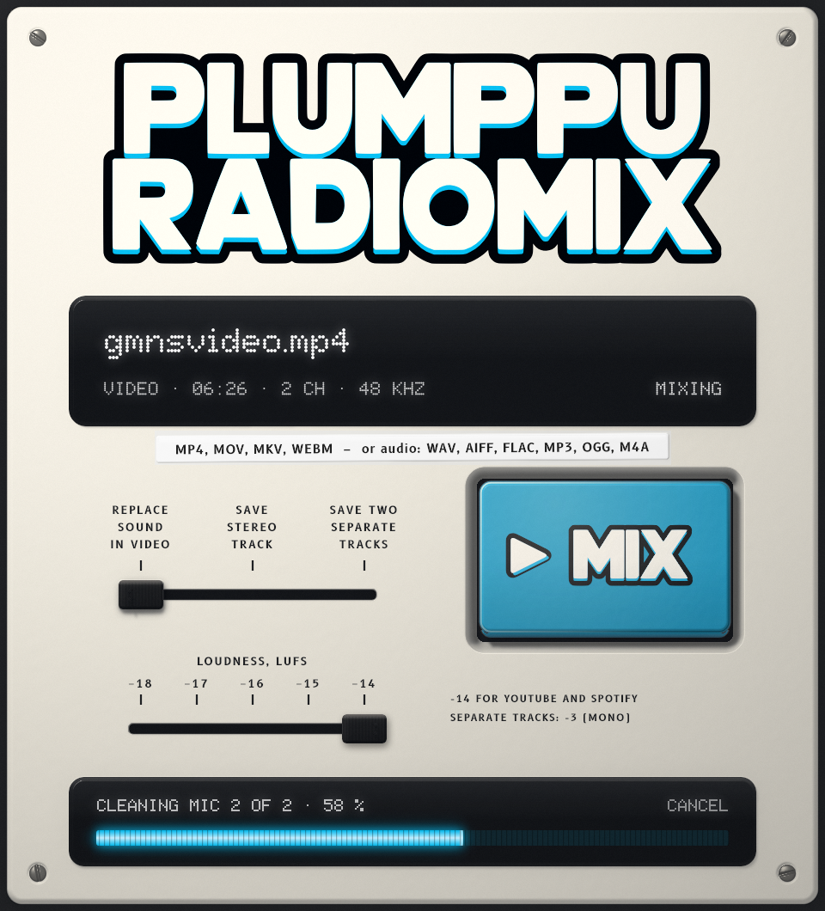

# Plumppu Radiomix

A small desktop app for recordings with **one speaker per channel** – a
two-mic interview, a podcast recorded to a stereo recorder, the sound of a
video shot with two lavalier mics. Drop the file on the display, pick what
to save with the slide switch and how loud with the slider below it, press
**MIX**.

Each mic is cleaned and levelled on its own, the mics are automixed so that
whoever is talking is up and the other mic is down (without gating the room
tone), and the result is delivered at the chosen loudness (-14 LUFS unless
the slider is moved) with an even loudness range and true peaks at or below
-1.5 dBTP:

1. **Read** the first audio stream (any sample rate, converted to 48 kHz).
   Plain audio is read directly; video and M4A/AAC go through
   [ffmpeg](https://ffmpeg.org), which must be installed (on PATH, or in
   `/opt/homebrew/bin` / `/usr/local/bin` on a Mac).
2. **Each mic: PlumppuVox Ren at 80** (noise, breaths and clicks out), then
   **PlumppuVox Lagom, LAGOM** (the level evened out).
3. **Automix** – a port of cppod's crosstalk-aware Dugan-style gain sharing:
   the mics' coupling is measured from the recording, each mic's evidence is
   corrected for the bleed the other predicts in it, and the gains share the
   power between the mics (a solo speaker at ~0 dB, two at once at ~-3 dB
   each).
4. **Lagom, LAGOM** once more on the mix.
5. **True-peak limiting at -1.5 dBTP** (peaks between samples estimated
   with 4x oversampling, as a meter does), with the level the limiting costs
   made back up and the limiting repeated until the result sits on the target.
   The video's sound is limited with 0.7 dB to spare for the AAC encoder.
   On a typical two-mic recording the stereo outputs stay under the ceiling
   by themselves; the mono separate tracks need some limiting.

A mono file, or one whose two channels are the same, skips the automix.

**Loudness.** The slider sets the target from -18 to -14 LUFS in 1 dB steps
(-14 for YouTube and Spotify, -16 for Apple Podcasts, -18 for a gentler
podcast level); the app remembers it. The target is what an output measures
as heard from two speakers: the mix is written as stereo with the same signal
on both channels, and the separate tracks, which are mono, 3 dB lower, so
that each measures the target once it is on a stereo track.

The slide switch chooses the result, written next to the input (never over
an existing file):

| Position | Writes |
|---|---|
| REPLACE SOUND IN VIDEO | `<name>-radiomix.<ext>`: the video copied untouched, the mix as its sound: the same on both channels (metadata and timecode kept). Video inputs only. |
| SAVE STEREO TRACK | `<name>-radiomix.wav`: the mix on both channels, 48 kHz / 24-bit |
| SAVE TWO SEPARATE TRACKS | `<name>-radiomix-mic1.wav`, `-mic2.wav`: each mic cleaned and levelled, not mixed; mono, 3 dB under the target |

The app speaks Swedish when the system does, English otherwise.

On a 6.4-minute 1080p video with one speaker per channel (the quieter one
about 11 dB down), a mix takes about 50 s. At -14, every output measures
-14.0 LUFS (ffmpeg's ebur128; the separate tracks -17.0 as mono); the video's sound has an LRA of 4.2 LU and a true peak
of -2.4 dBTP after AAC encoding, without any limiting.

## Command line

    "Plumppu Radiomix" --mix <file> [--output replace|stereo|separate] [--target -14..-18]
    "Plumppu Radiomix" --selfcheck
    "Plumppu Radiomix" --snapshot out.png [--state empty|ready|mixing] [--file f] [--lang en|sv] [--loudness -14..-18]

`--selfcheck` builds a two-mic recording (speakers taking turns, one 12 dB
quieter, each mic hearing the other 18 dB down), mixes it and checks the
loudness and true peak of every output, the balance between the speakers
and that REPLACE SOUND refuses audio. CI runs it.

## Build

Radiomix is built with the plugins from the root of this repository
(`cmake -S . -B build && cmake --build build`); the app ends up in
`build/PlumppuRadiomix_artefacts/Release/`. `-DPLUMPPUVOX_BUILD_RADIOMIX=OFF`
leaves it out.

## Layout

- `radiomix/src/Mixer.*` – the processing chain, on a background thread
- `radiomix/src/Automix.*` – the automix (from cppod's `automix.py`)
- `radiomix/src/Media.*` – reading files, ffmpeg, writing the video back
- `radiomix/src/Faceplate.*` – the panel: relief, logo, displays
- `radiomix/src/Console.*` – the window's component: files, switch, key
- `radiomix/src/Texts.h` – every text, in English and Swedish
- `radiomix/NOTES.md` – the design notes it was built from
- Uses Ren's engine (`engine/`), Lagom's rider (`lagom/src/Rider.*`) and the
  shared look (`src/plumppu/`)

Fonts: B612 and [Matrix Sans](https://github.com/FriedOrange/MatrixSans)
(SIL Open Font License, `assets/fonts/`). Licence: GNU AGPL v3, as the rest of
the repository.
